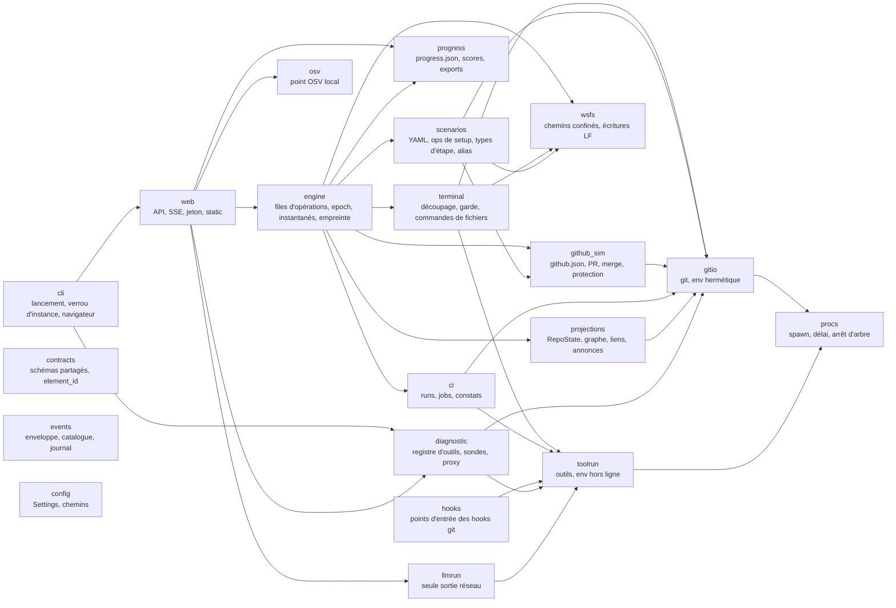
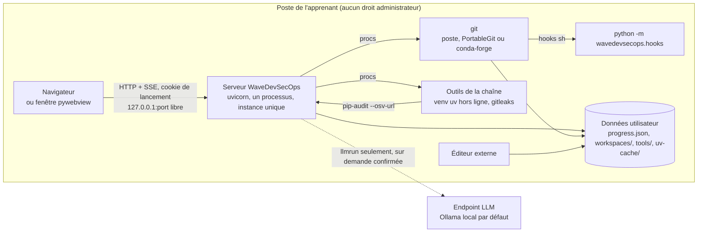

# Architecture Spine — WaveDevSecOps

## Design Paradigm

**Moteur à un seul écrivain, vues en projection.** La vérité est sur disque : le bac à sable, `origin.git`, `github.json` et `hooks/` d'un espace de travail. Toute mutation d'un espace passe par sa file d'opérations, tenue par le moteur. Après chaque opération, le serveur relit l'état réel et publie des projections ; le navigateur ne fait que les dessiner. Git, les outils de la chaîne et le système de fichiers sont derrière des adaptateurs (hexagonal) : le confinement et l'environnement hermétique ne se règlent qu'à un seul endroit.



Règles de dépendance :
- Les flèches ne remontent jamais. Personne n'importe `web` ni `cli`.
- `contracts`, `events` et `config` sont des feuilles : elles n'importent rien du projet, et tout module peut les importer (flèches omises).
- Seul `procs` crée des sous-processus ; seuls `gitio` et `toolrun` l'appellent. Seul `llmrun` demande un processus autorisé à sortir sur le réseau (AD-13).
- Seul `wsfs` lit ou écrit un fichier d'un bac à sable pour le compte de l'apprenant (terminal, vue Code, setup).
- `hooks` s'exécute dans un processus lancé par git ; il lit `github.json` et `Settings`, et ne parle jamais au serveur.

## Invariants & Rules

### AD-1 — Un seul écrivain par espace, une file d'opérations ordonnée

- **Binds:** engine, web, terminal, scenarios, github_sim, ci ; FR-1, FR-3, FR-4, FR-10, FR-15, NFR-7
- **Prevents:** deux chemins qui modifient un espace en même temps ; une explication affichée avant les vues ; un résultat de pipeline écrit après un Recommencer ; un rafraîchissement externe pendant une commande.
- **Rule:**
  - Chaque espace a sa file d'opérations, exécutée en série. Une opération est une intention typée (AD-17) : ligne du terminal, enregistrement de fichier, choix de quiz, réponse désignée, ouverture d'indice, rétablissement, Recommencer, ouverture ou merge de PR, relance d'un check, résultat de job, changement externe détecté, exécution du code d'exercice.
  - L'état d'un espace est l'un de `idle`, `command`, `quiz_altered`, `restoring`, `setup`, `exporting`, émis par `engine_state{state, reason_text}`. Les runs du pipeline sont suivis à part (`pipeline_runs[]`, AD-10) et ne changent pas cet état.
  - Chaque opération suit cet ordre fixe, émis comme événements : sortie (flux) → relecture de l'état et projections → validation de l'étape → explication. Aucun module ne publie une explication hors de cette séquence.
  - Chaque espace porte un `epoch`, incrémenté à l'entrée de `restoring` et de `setup`. Toute opération produite hors de la file (job terminé, changement externe) porte l'`epoch` de sa création ; la file rejette celle dont l'`epoch` n'est plus le courant.
  - Le surveillant (`watchfiles`) ne regarde que l'arbre de travail, hors `.git/`. Il est suspendu pendant `command`, `setup` et `restoring`, et reprend après un délai de silence. Il ne crée l'opération « changement externe » que si l'empreinte de l'arbre diffère de celle de la dernière projection.
  - En `quiz_altered`, les écritures de la vue Code sont refusées comme celles du terminal.
  - Un enregistrement de fichier porte le `base_hash` du contenu lu ; si le disque a changé depuis, il est refusé avec le choix « Garder ma version » ou « Recharger » (UX, modification externe).
  - Au plus `Settings.max_active_workspaces` espaces sont actifs (file, surveillant, runs) ; les autres dorment et se rouvrent à la demande.

### AD-2 — État réel sur disque, projections calculées par le serveur

- **Binds:** projections, contracts, web, front ; FR-4, FR-5, FR-11, FR-12, FR-13, FR-34, NFR-2, NFR-13
- **Prevents:** un front qui déduit l'état git de la sortie du terminal ; deux vues qui nomment différemment le même élément ; un graphe dont les commits changent de place sans raison git ; des annonces d'accessibilité écrites différemment par chaque vue.
- **Rule:**
  - Après chaque opération, `projections` construit un `RepoState` (schéma dans `contracts`) à partir des lectures internes de git (AD-3) et de `github.json` : commits accessibles et commits perdus encore dans le reflog, refs locales et de `origin`, tags, index, arbre de travail, stash, PR, checks, journal de revue.
  - Le placement du graphe est calculé côté serveur. Il est déterministe : un commit garde sa colonne et son rang tant que ses refs et ses parents accessibles n'ont pas changé. Un test le vérifie sur une suite d'états.
  - **`element_id`** : grammaire unique, générateur et analyseur dans `contracts`, segments encodés en pourcentage. Formes : `commit:<sha40>`, `ref:<nom complet>`, `path:<head|index|worktree>:<chemin posix>`, `diffline:<sha40|index|worktree>:<chemin>:<old|new>:<ligne>`, `pr:<n>`, `check:<pr>:<job_id>:<head_sha40>`, `review:<pr>:<n>`, `sbom:<paquet>@<version>`, `tag:<nom>`, `output:<op_id>`, `outline:<op_id>:<ligne>`, `barrier:<id>`, `env:<staging|prod>`. Chaque vue déclare dans le registre des volets les types qu'elle émet ; un test refuse un type non déclaré.
  - **Annotations portées par la projection**, jamais calculées par le front : marques `new`, `restored`, `lost`, `designable` ; `a11y_name_text` de chaque nœud du graphe (gabarit de l'UX) ; `links` (les `element_id` liés, selon la table de correspondances de l'UX) ; `explain_ref` (clé du catalogue d'explications) ; `announce_text` de la région `role="status"` ; raisons de blocage `[{text, element_id}]` ; disponibilité d'un indice et sa raison.
  - **Sorties** : chaque ligne de `terminal_output` porte `lang` (`fr` ou `en`, déterminé par le serveur) et des `spans` liables (SHA, ref, chemin, fichier:ligne) résolus contre le `RepoState` ; seuls les éléments qui existent dans le bac à sable sont liables.
  - La correction d'une désignation est faite par le serveur, contre le `RepoState` courant et l'ensemble de bonnes réponses de l'étape (AD-7).
  - Le front peut : mettre en forme, filtrer, faire défiler, tenir un chronomètre local, mémoriser la disposition des volets. Il ne calcule ni score, ni disponibilité, ni correspondance, ni texte d'annonce.

### AD-3 — Deux contextes d'appel git, un environnement hermétique

- **Binds:** gitio, terminal, scenarios, github_sim, ci, hooks ; NFR-2, NFR-3, NFR-5, FR-1
- **Prevents:** des SHA différents selon l'OS ; un `core.autocrlf` ou un alias du poste qui change le comportement ; une analyse de messages git traduits ; un git qui attend une saisie.
- **Rule:**
  - **Contexte apprenant** (commandes tapées, choix de quiz) : locale française. `gitio` sonde au lancement une locale disponible (`fr_FR.UTF-8`, puis `fr_FR.utf8`) et pose `LANG`, `LC_ALL` et `LANGUAGE=fr` ; sans locale française, git parle anglais. La sortie est affichée telle quelle et n'est jamais analysée pour en tirer un état.
  - **Contexte interne** (projections, validation, setup, github_sim, ci) : `LC_ALL=C`, `LANGUAGE` vide, commandes plumbing ou porcelain stables (`for-each-ref`, `rev-list`, `cat-file`, `status --porcelain=v2 -z`, `ls-files -s -z`, `stash list`, `reflog`). Rien n'est affiché.
  - **Environnement commun, posé par `gitio` seul :**
    - `GIT_CONFIG_NOSYSTEM=1` et `GIT_CONFIG_GLOBAL` vers `<data>/gitconfig` ;
    - réglages forcés par `GIT_CONFIG_COUNT` / `GIT_CONFIG_KEY_n` / `GIT_CONFIG_VALUE_n`, qui priment sur la config du dépôt : `core.autocrlf=false`, `core.eol=lf`, `core.filemode=false`, `core.symlinks=false`, `core.longpaths=true`, `core.quotePath=false`, `core.hooksPath=<espace>/hooks`, `core.pager=cat`, `core.editor=:`, `sequence.editor=:`, `init.defaultBranch=main`, `commit.gpgsign=false`, `tag.gpgsign=false`, `core.fsmonitor=false`, `gc.auto=0`, `maintenance.auto=false`, `credential.helper=` vide ;
    - `GIT_TERMINAL_PROMPT=0`, `GIT_MERGE_AUTOEDIT=no`, `GIT_PAGER=cat`, `GIT_EDITOR=:`, entrée standard fermée, variables de proxy retirées.
  - **Éditeur.** `:` accepte le message proposé : `revert`, `merge --continue`, `rebase --continue` et `commit --amend` aboutissent sans éditeur. Un `commit` ou un `tag -a` sans message échoue avec la sortie de git elle-même ; `terminal` reconnaît ce cas sur l'argv et le code de sortie, et ajoute un `terminal-app-message` (« git attend un message de commit. Ajoutez `-m "…"`. »).
  - **Déterminisme du setup.** Les ops de setup (AD-7) fixent `GIT_AUTHOR_DATE`, `GIT_COMMITTER_DATE`, noms et e-mails, et écrivent les fichiers en LF par `wsfs` : un même scénario donne les mêmes SHA sur les trois systèmes. Le dépôt de l'application porte un `.gitattributes` `* text=auto eol=lf` ; l'installeur clone avec `-c core.autocrlf=false`.

### AD-4 — Terminal sans shell, double liste blanche

- **Binds:** terminal, wsfs ; FR-1, FR-2, FR-3, FR-15, FR-21, FR-29 ; question ouverte 7 du PRD
- **Prevents:** une sortie du bac à sable par un alias `!`, un `-C`, un `--exec`, un `--output` ou une URL ; un comportement de commande de fichier qui diffère entre Windows et Unix ; une saisie en lecture seule contournée pendant le quiz.
- **Rule:**
  - Pas de shell ni de PTY. Une ligne est découpée en argv par un découpeur de type POSIX (guillemets simples et doubles, antislash). Sont refusés avec explication : `|`, `&&`, `||`, `;`, `$(…)`, backquotes, `$VAR`, `<`, et toute redirection autre que `>` et `>>` après `echo`. Aucune expansion de glob côté terminal : git reçoit ses pathspecs telles quelles.
  - **Commandes de fichiers**, implémentées en Python dans `terminal`, sur `wsfs` : `ls [-a] [chemin]`, `cat <fichier>…`, `echo <texte> [> | >> fichier]`, `touch`, `mkdir [-p]`, `rm [-r] [-f]`, `mv`, `cp`, `pwd`, `clear`. `rm`, `mv` et `cp` acceptent `*` et `?`, résolus dans le bac à sable. Le répertoire courant est toujours la racine du bac à sable ; `cd` est refusé avec explication.
  - **`wsfs`** est le seul résolveur de chemin, utilisé aussi par la vue Code et « Ouvrir dans mon éditeur » : chemin résolu sous la racine du bac à sable, hors de `.git/`, sans lien symbolique sortant. Il écrit en UTF-8 sans BOM, en LF (`\r\n` normalisé en `\n`).
  - **git** : sous-commande dans une liste blanche, et pour chaque sous-commande une liste blanche d'options. Sous-commandes : `add`, `commit`, `status`, `log`, `diff`, `show`, `branch`, `switch`, `checkout`, `restore`, `reset`, `revert`, `merge`, `rebase`, `stash`, `tag`, `push`, `pull`, `fetch`, `remote` (lecture), `reflog`, `rm`, `mv`, `config` (lecture, et écriture de `user.name` / `user.email`), `blame`, `shortlog`, `ls-files`, `rev-parse`, `cat-file`. Toute option hors liste est refusée ; ne sont jamais admises `-c`, `-C`, `--git-dir`, `--work-tree`, `--exec-path`, `--config-env`, `--exec`/`-x`, `-i`/`-p` interactifs, `--output`, `--no-index`, `--upload-pack`, `--receive-pack`, `--ext-diff`, `-F`. Le dépôt cible de `push`, `pull` et `fetch` est un remote existant, jamais un chemin ni une URL.
  - **Outils de station** : `ruff`, `pytest`, `pre-commit run`, `gitleaks`, `bandit`, `pip-audit` ne sont acceptés que si l'étape courante les déclare. Ils passent par `toolrun` (AD-12). `pre-commit install` est refusé avec explication : les hooks sont posés par le setup.
  - En `quiz_altered`, seules les commandes marquées « lecture » dans la liste blanche sont acceptées.
  - Les listes blanches vivent dans un seul fichier de données, lu par la garde et par le texte du refus, qui cite la liste acceptée.
  - Ctrl+C appelle `procs.terminate_tree` sur la commande en cours.
  - Modèle de menace : l'erreur de l'apprenant, pas un apprenant malveillant. Un éditeur externe peut encore écrire dans `.git/` ; AD-3 neutralise la config du dépôt, et Recommencer répare.

### AD-5 — Espace de travail : disposition et propriétaires

- **Binds:** engine, scenarios, github_sim, ci, progress, config, toolrun ; FR-9, FR-10, FR-16, FR-20
- **Prevents:** deux modules qui écrivent le même fichier ; un bac à sable dans un dossier synchronisé par OneDrive ; deux parcours qui partagent un état ; un environnement Python sans propriétaire.
- **Rule:**
  - Racine des données : `platformdirs.user_data_dir("WaveDevSecOps", appauthor=False, roaming=False)` (sous Windows, `%LOCALAPPDATA%\WaveDevSecOps`).
  - Disposition :

    ```text
    <data>/
      app.lock                            # cli (AD-20)
      install.json                        # installeur : horodatage d'installation, versions
      progress.json                       # progress seul (AD-14)
      gitconfig                           # GIT_CONFIG_GLOBAL (AD-3)
      tools/                              # git portable, gitleaks (AD-15)
      uv-cache/                           # UV_CACHE_DIR, préchargé à l'installation (AD-12)
      logs/                               # journaux de l'application
      workspaces/<parcours>/<scenario_id>.<mode>/
        repo/                             # bac à sable : écrit par git (gitio) et par wsfs
        origin.git/                       # écrit par git (push) et par github_sim (merge)
        github.json                       # github_sim seul
        hooks/                            # scenarios au setup, puis lecture seule
        run.json                          # engine seul : epoch, étape, quiz, restauration en cours, content_hash
        snapshots/<id>/                   # engine seul (AD-6)
        ci/<pr>-<sha7>/                   # ci seul ; jetable, hors instantanés
        cache/                            # venv/ d'exercice, PRE_COMMIT_HOME, caches d'outils ; hors instantanés
    ```
  - Un espace par parcours, par scénario et par mode. Ouvrir un scénario commencé reprend son espace.
  - Les chemins écrits dans les fichiers de données sont relatifs à la racine de l'espace, en notation posix.

### AD-6 — Instantanés par copie, vérifiés par empreinte

- **Binds:** engine ; FR-10, FR-12, FR-15 ; question ouverte 2 du PRD
- **Prevents:** une restauration partielle (stash, index, hooks ou état des PR oubliés) ; un apprenant laissé sur un état faux ; « octet pour octet » interprété différemment par deux stories ; une restauration interrompue qui laisse un espace à moitié copié.
- **Rule:**
  - Un instantané est une copie de `repo/`, `origin.git/`, `github.json` et `hooks/` dans `snapshots/<id>/`, avec son empreinte. L'instantané 0 est pris à la fin du setup, avant tout run du pipeline ; un instantané est pris avant chaque choix de quiz. Rétention : `Settings.max_snapshots`, le 0 et le dernier toujours gardés.
  - **Empreinte canonique** (sha256 d'une sérialisation triée) : refs et cibles de `repo/` et `origin.git/` (HEAD symbolique compris) ; objets accessibles depuis les refs et le reflog ; entrées de l'index (mode, oid, étage, chemin) ; contenu et chemin de chaque fichier suivi ou non ignoré de l'arbre de travail ; liste du stash ; contenu de `hooks/` ; `github.json` sérialisé de façon canonique, sans `checks[].output`, durées ni horodatages. Les dates de fichier, les fichiers ignorés, `ci/` et `cache/` en sont exclus. « Identique octet pour octet » (FR-10, FR-12, FR-15) veut dire : même empreinte.
  - **Restauration** : `epoch` incrémenté, runs du pipeline de l'espace arrêtés et `ci/` vidé, surveillant suspendu ; `run.json` reçoit `restoring{snapshot_id, phase}` avant le premier renommage ; dossiers courants renommés vers une corbeille, copie de l'instantané, empreinte comparée ; `restoring` effacé. Trois essais espacés en cas de verrou de fichier sous Windows. Tout écart ou toute exception donne `restore_failed`, avec la seule action « Recommencer ».
  - Au démarrage, un `restoring` résiduel reprend la copie, ou passe en `restore_failed`. L'empreinte d'un espace repris est recalculée ; un écart avec la dernière projection donne une opération « changement externe ».
  - **Recommencer** restaure l'instantané 0. S'il manque ou si cette restauration échoue, l'espace est supprimé puis reconstruit par son setup, et l'empreinte est comparée à celle de référence (AD-18). Si cela échoue aussi, l'erreur est affichée avec « Voir le diagnostic ».

### AD-7 — Scénarios déclaratifs : ops de setup, types d'étape, alias

- **Binds:** scenarios, content ; FR-9 à FR-16, FR-21 à FR-35, NFR-3, NFR-10
- **Prevents:** un scénario qui dépend du précédent ; une validation sur le texte tapé ; un nouveau type d'étape qui impose de modifier les scénarios existants ; une bonne réponse écrite en SHA que l'auteur ne connaît pas ; un agent B qui n'est pas rejouable.
- **Rule:**
  - Un scénario est un fichier YAML validé par un modèle pydantic (`schema_version`). Il déclare : `scenario_id`, mode (A ou B), section et station, parcours servis, outils requis (identifiants d'AD-16), gabarit d'exercice de départ, `setup` (liste d'ops), protection et règles de PR initiales, réactions du collègue simulé, puis ses étapes.
  - **Ops de setup** : un registre ; une op par module dans `scenarios/ops/`, avec le modèle pydantic de ses arguments (`write_file`, `commit`, `branch`, `push`, `colleague_commit`, `agent_commit`, `agent_push_force`, `stash`, `open_pr`, `set_protection`, `install_hooks`, …). Les actes de l'agent B et du collègue sont des ops, avec identité et dates fixes. Aucun vrai LLM n'intervient. Le setup ne lance jamais `ci`.
  - **Alias** : une op peut porter `as: <alias>`. Le YAML désigne les éléments par `@alias` (`commit:@agent-env`, `ref:@feature`, `path:worktree:@secret`), résolus en `element_id` par le contexte de l'étape.
  - **Types d'étape** : un registre ; un type par module dans `scenarios/steps/`, avec son modèle pydantic et `check(state: RepoState, ctx) -> Verdict`. Un nouveau type ne touche ni le moteur ni les scénarios existants. Un état ni attendu ni prévu donne le verdict `unexpected`, avec ce qui était attendu.
  - Une étape a un `step_id` stable et unique dans son scénario. Elle porte en français sa consigne, son explication, trois paliers d'indice et, pour une question, son ensemble de bonnes réponses (élément principal et équivalents, en alias). Les explications attachées par type d'élément (NFR-13) sont dans `content/explanations.yaml`.
  - Le gabarit de chaque parcours est dans `content/exercise/<parcours>/`, avec `pyproject.toml`, `uv.lock`, `tests/`, `.gitignore`, `.pre-commit-config.yaml` et les trois écritures du pipeline. Seul le code d'exercice diffère entre les parcours (FR-16).
  - Un lint de contenu (en CI, AD-18) charge tous les YAML et vérifie ops, types d'étape, outils, `job_id`, barrières, clés d'explication, alias et `step_id`.

### AD-8 — GitHub simulé : un propriétaire, des checks liés au SHA

- **Binds:** github_sim, hooks, ci, projections ; FR-6, FR-7, FR-8, FR-22, FR-28, FR-30
- **Prevents:** un modèle de PR à refondre pour les stations ; un merge accepté sur les checks verts d'un ancien SHA ; un merge qui contourne la protection ; deux écrivains de `github.json`.
- **Rule:**
  - `github.json` n'est écrit que par `github_sim`, par écriture atomique, depuis une opération de la file. `hooks` et `projections` le lisent.
  - Le modèle de PR porte dès v0.1 : numéro, tête, base, état, `head_sha`, `base_sha`, checks, revues et approbations, approbations requises, règles de protection de la base. Un check porte `job_id`, `head_sha`, `base_sha`, état `queued|running|success|failure|error`, obligatoire, sortie et constats.
  - Quand `head_sha` ou `base_sha` d'une PR change, ses checks repassent à `queued` dans la même écriture, et un run est demandé au `ci`. Après tout changement des refs de `origin`, `mergeable` est recalculé pour toutes les PR ouvertes.
  - Une PR est mergeable si chaque check obligatoire est `success` pour ses `head_sha` et `base_sha` courants, que les approbations requises sont atteintes et qu'il n'y a pas de conflit. Les raisons de blocage sont calculées par `github_sim`, chacune avec son `element_id`.
  - Le merge s'écrit dans `origin.git` sans worktree : `git merge-tree --write-tree`, `git commit-tree`, `git update-ref` avec l'ancienne valeur attendue. Message et identité fixés par `github_sim`.
  - La protection est réelle : le hook `pre-receive` refuse la mise à jour d'une branche protégée et écrit son refus en français sur stderr (git l'affiche avec `remote:`). Le merge de `github_sim` ne passe pas par `receive-pack`.
  - Les revues du collègue simulé sont des réactions déclarées par le scénario, déclenchées par des événements de PR (ouverture, push, checks terminés).

### AD-9 — Hooks git en sh, vers un point d'entrée Python

- **Binds:** hooks, scenarios, gitio ; FR-21, FR-22, FR-28, NFR-5
- **Prevents:** un hook qui exige bash ; un pre-commit qui télécharge ses dépôts de hooks ; deux façons de poser un hook ; un hook en CRLF.
- **Rule:**
  - Tout hook est un script `#!/bin/sh` d'une ligne, généré par l'op `install_hooks` (jamais copié depuis le dépôt de l'application), en LF : `exec "<python de l'app>" -m wavedevsecops.hooks <nom> "$@"`, chemins en notation posix et entre guillemets. Aucun hook n'utilise bash.
  - Un seul dossier `hooks/` par espace, désigné par `core.hooksPath` (AD-3), sert `repo/` et `origin.git/`. Le point d'entrée distingue le dépôt par `GIT_DIR` : `pre-commit` n'agit que dans `repo/`, `pre-receive` que dans `origin.git/`. Les hooks actifs sont déclarés par l'étape (`hooks_enabled` dans `run.json`).
  - Le hook pre-commit de la station 1 lance le vrai `pre-commit run` sur le `.pre-commit-config.yaml` du gabarit, qui n'a que des hooks `repo: local` avec `language: system` (gitleaks, ruff). `PRE_COMMIT_HOME` pointe vers `cache/`.
  - Un hook qui manque d'un outil sort en échec avec un message en français qui renvoie au diagnostic.

### AD-10 — Pipeline simulé : vrais outils, runs liés au SHA, sortie verbatim

- **Binds:** ci, github_sim, toolrun, content ; FR-22 à FR-28 ; question ouverte 4 du PRD
- **Prevents:** une sortie d'outil réécrite ; des constats tirés d'un texte humain ; un run qui écrit après un Recommencer ; des lignes des trois fichiers CI codées en dur.
- **Rule:**
  - Le pipeline est décrit une seule fois, dans `content/pipeline.yaml` : `job_id`, libellé, argv de la sortie humaine, argv de la sortie machine, obligatoire, sens des codes de sortie (succès, échec, erreur de l'outil). Les argv peuvent citer les jetons `{osv_url}`, `{base_sha}`, `{repo}`, remplacés par `ci`.
  - Un run a pour clé `(pr, head_sha, base_sha)` et l'`epoch` de l'espace. Un seul run actif par espace ; les autres attendent en file. Un nouveau SHA de la même PR annule le run en cours (`procs.terminate_tree`).
  - `ci` clone `origin.git` dans `ci/<pr>-<sha7>/` (`git clone --shared`, checkout du SHA), crée l'environnement de test hors ligne (AD-12), puis exécute les jobs en série. Chaque résultat de job est soumis à la file comme opération portant l'`epoch` (AD-1) ; seule cette opération écrit dans `github.json` et émet `check_updated`.
  - La sortie affichée est la sortie humaine de l'outil, verbatim. Les constats structurés (fichier, ligne, règle, dépendance, vulnérabilité, couverture et seuil) viennent d'une exécution machine du même outil sur le même arbre (`bandit -f json`, `pip-audit -f json`, `coverage json`, `diff-cover --format json:`), jamais de l'analyse du texte humain.
  - La quality gate est le job `quality_gate` : `pytest --cov` puis `diff-cover` contre `{base_sha}` avec `--fail-under=80`.
  - Les trois écritures (`.github/workflows/ci.yml`, `Jenkinsfile`, `.gitlab-ci.yml`) font partie du gabarit et ne sont jamais exécutées. Chaque tâche y est encadrée par deux commentaires `wds:job <job_id>` et `wds:end`. `ci` en tire les plages de lignes sur le SHA de tête ; des balises absentes donnent un constat non bloquant, jamais une exception. Un test vérifie que chaque `job_id` est présent dans les trois fichiers du gabarit.
  - `ruff`, `pytest` et `gitleaks` lancés dans le terminal suivent la même règle : sortie humaine affichée, constats (liens fichier:ligne) tirés d'une exécution machine.

### AD-11 — pip-audit hors ligne : vrai outil, point OSV local figé

- **Binds:** osv, ci, content, config ; FR-25, NFR-1, NFR-3, SM-C2 ; question ouverte 3 du PRD
- **Prevents:** un appel à `api.osv.dev` ou à PyPI ; un résultat qui change avec la date ; une sortie de pip-audit simulée ; un interblocage entre l'outil et le serveur.
- **Rule:**
  - pip-audit est lancé pour de vrai avec `--vulnerability-service osv --osv-url {osv_url}`, sans résolution (`--no-deps`, `--disable-pip`, dépendances épinglées exactement). Le job pip-audit fait trois exécutions sur le même arbre : sortie humaine (affichée), `-f json` (constats), `-f cyclonedx-json` (SBOM, lu par `sbom-view`).
  - `Settings.osv_url` vaut `http://127.0.0.1:<port>/osv/v1/query`, port du serveur ; c'est la seule source de cette URL.
  - `osv` sert `POST /osv/v1/query` depuis `content/osv/`, un extrait d'enregistrements OSV réels copiés tels quels pour les paquets des gabarits. Le point ne prend aucun verrou et n'attend aucune file ; `toolrun` n'occupe jamais la boucle du serveur pendant qu'un outil tourne.
  - L'extrait porte sa date ; l'explication du check la cite (« base embarquée, figée au … »). Il est mis à jour par un script de maintenance, jamais à l'exécution.

### AD-12 — Exécution des outils : hors ligne, hermétique, arrêt d'arbre

- **Binds:** procs, toolrun, ci, terminal, hooks, diagnostic ; NFR-1, NFR-4, NFR-5, FR-21, FR-25
- **Prevents:** un `uv sync` qui sort sur le réseau ; un proxy qui intercepte l'appel de pip-audit à `127.0.0.1` ; un outil pris dans le PATH du poste ; un processus orphelin après Ctrl+C ; des caches d'outils écrits dans le bac à sable.
- **Rule:**
  - `procs.spawn(argv, env, cwd, timeout) -> Handle` est le seul lanceur de sous-processus, non bloquant pour la boucle du serveur. `terminate_tree()` arrête l'arbre : groupe de processus sous Unix, Job Object sous Windows. Après un arrêt, `gitio` supprime un `index.lock` périmé puis relance la projection. Délai par défaut dans `Settings`.
  - `toolrun` résout chaque outil par le registre d'AD-16, jamais par le PATH.
  - Environnement : `UV_OFFLINE=1`, `UV_CACHE_DIR=<data>/uv-cache`, `UV_PYTHON_DOWNLOADS=never`, `UV_PYTHON_PREFERENCE=only-managed`, `PIP_NO_INDEX=1`, `NO_PROXY` et `no_proxy` à `127.0.0.1,localhost`, `HTTP(S)_PROXY` et `ALL_PROXY` retirés, `PYTHONUTF8=1`, `PYTHONDONTWRITEBYTECODE=1`, `RUFF_CACHE_DIR`, `COVERAGE_FILE` et `PRE_COMMIT_HOME` dans `cache/`, `PYTEST_ADDOPTS=-p no:cacheprovider`, entrée standard fermée.
  - L'installation précharge dans `uv-cache` l'interpréteur Python géré et chaque version de paquet qu'un état de scénario peut demander, y compris la version corrigée d'une dépendance vulnérable. L'environnement d'exercice d'un espace (`cache/venv/`) et ceux des runs sont créés par `uv sync --offline --frozen` depuis le `uv.lock` du gabarit.
  - Les outils de la chaîne (ruff, pytest, pytest-cov, coverage, diff-cover, bandit, pip-audit, pre-commit) sont des dépendances du gabarit, verrouillées dans son `uv.lock`, et un groupe `chain` du projet, à la même version. gitleaks est le binaire de `tools/`.

### AD-13 — Aucun appel réseau, sauf `llmrun`

- **Binds:** tous les modules, llmrun, CI du projet ; NFR-1, NFR-9, FR-17, FR-28 ; question ouverte 6 du PRD
- **Prevents:** une télémétrie ou une police chargée par CDN ; une bibliothèque réseau importée par commodité ; un outil qui sort sur le réseau sans qu'on le voie ; une exécution LLM déclenchée par un scénario.
- **Rule:**
  - Le code de l'application n'ouvre aucune connexion sortante. Seul `llmrun` demande un processus autorisé à sortir : `python -m <point d'entrée>` du code d'exercice, dans `cache/venv/`, avec les variables de proxy de l'apprenant rétablies, sur l'intention `run_exercise_code{confirmed: true}` seulement. L'opération passe par la file en état `command`, après un instantané. Aucune étape ne l'émet.
  - Le code d'exercice du parcours LLM appelle une API compatible OpenAI (`/v1/chat/completions`) avec `httpx`. Sa config (`llm.toml` du gabarit) vise par défaut Ollama sur `http://127.0.0.1:11434/v1` et déclare les endpoints autorisés, que le test de FR-28 vérifie. Ni un scénario ni le pipeline n'exécutent le code d'exercice ; ses tests remplacent l'appel réseau.
  - Le front est servi en entier par l'application : scripts, styles, polices WOFF2, bibliothèques vendorisées. Aucune URL externe dans `static/`.
  - Contrôles en CI : (1) analyse statique qui refuse dans `src/` tout import de `socket`, `http.client`, `urllib.request`, `httpx`, `requests`, `aiohttp`, `ssl`, hors `llmrun` et hors l'écoute de `web` et `cli` ; (2) recherche d'URL `http(s)://` non loopback dans `static/` ; (3) tests sous un hook d'audit `socket.connect` qui échoue sur toute adresse non loopback ; (4) sous Linux, la suite de scénarios et du pipeline rejouée dans un espace de noms sans réseau (`unshare -n`), ce qui couvre les sous-processus.

### AD-14 — Suivi : un fichier, un propriétaire, le premier passage fait foi

- **Binds:** progress, engine, web ; FR-10, FR-13, FR-16, FR-20, FR-34, FR-35, FR-36, SM-1 à SM-8
- **Prevents:** un score recalculé par le front ; un Recommencer qui améliore le score du premier coup ; un fait perdu ou compté deux fois après un arrêt brutal.
- **Rule:**
  - `progress.json` n'est écrit que par `progress`, sous un verrou unique, par écriture atomique. Il porte `schema_version`, l'horodatage d'installation (lu dans `install.json`) et celui du premier lancement.
  - Il enregistre des faits, en ajout seulement, par parcours et par `(scenario_id, mode, step_id)` : premier essai de chaque quiz ou désignation (juste ou non), indices (palier, temps avant la demande, temps de lecture), remises à zéro (consignées après succès), étapes validées, scénarios terminés, dernier scénario ouvert, preuves vues par barrière. Chaque fait a une clé d'idempotence `(workspace_id, epoch, op_id)` ; un doublon est ignoré. Le moteur écrit `run.json` d'abord, puis soumet les faits ; au démarrage, il soumet ceux qui manquent.
  - Les scores, les états « À faire / En cours / Terminé » et la disponibilité de « Reprendre » sont dérivés de ces faits par `progress`. Un fait du premier passage n'est jamais remplacé.
  - Les exports (rapport FR-36, fiche FR-35) sont produits par `progress` et rendus par Jinja2 : HTML autonome (styles et polices en ligne) et CSV UTF-8 avec BOM, séparateur `;`. Le navigateur les télécharge ; la fenêtre pywebview passe par la boîte d'enregistrement du système.
  - La fiche lit `content/barriers.yaml` : barrière, risque, preuve attendue, correspondances ISO 27001, NIS2, DORA, CRA, chacune « explicite » ou « interprétation ».

### AD-15 — Installation sans droits administrateur, git en français quand c'est possible

- **Binds:** install.ps1, install.sh, diagnostic, config ; FR-18, FR-19, NFR-5, NFR-12 ; question ouverte 1 du PRD et point UX « git en locale française »
- **Prevents:** un git sans bash ni traductions par défaut sous Windows ; une installation qui exige un compte administrateur ; un téléchargement non vérifié.
- **Rule:**
  - L'installeur (PowerShell sous Windows, sh sous macOS et Linux) installe uv dans le profil de l'utilisateur, récupère l'application (clone avec `-c core.autocrlf=false`, ou zip), lance `uv sync`, précharge `uv-cache` (AD-12), provisionne git et gitleaks dans `<data>/tools/`, puis écrit `install.json`. Il respecte `HTTPS_PROXY` et pose `UV_SYSTEM_CERTS=true` si un proxy est détecté. Il dit en français quoi régler en cas d'échec et propose la voie clone ou zip.
  - **git.** Un git du poste à la version minimale ou plus (AD-16) est utilisé tel quel. Sinon :
    - Windows : PortableGit de Git for Windows, extrait sans droits administrateur (`-y -gm2 -InstallPath=…`). MinGit est écarté : il n'a ni bash ni messages traduits, donc git y parlerait anglais.
    - macOS et Linux : `pixi global install git` (conda-forge), dans le profil de l'utilisateur.
    - Sous macOS, le diagnostic teste `xcode-select -p` avant d'appeler `/usr/bin/git`, pour ne pas ouvrir la fenêtre d'installation des outils Xcode.
  - **gitleaks** : archive officielle de la release GitHub pour l'OS et l'architecture, vérifiée par le `checksums.txt` de la release, extraite dans `tools/`. Une somme fausse arrête l'installation de l'outil, avec un message en français.
  - Les versions provisionnées et les URL sont dans `tools.toml` (AD-16).

### AD-16 — Registre d'outils unique, versions minimales

- **Binds:** diagnostic, toolrun, scenarios, catalogue, install ; FR-19, FR-21 à FR-26 ; point UX « versions minimales »
- **Prevents:** un diagnostic, un catalogue et un installeur qui ne s'accordent pas sur un outil ; un scénario marqué disponible alors que son outil manque.
- **Rule:**
  - `tools.toml` est la seule source : identifiant, usage, jalon, résolution, version minimale, version provisionnée, sonde de version, accès réseau possible de l'outil et réglage qui le coupe. Le diagnostic, `toolrun`, la disponibilité des scénarios et les installeurs le lisent. Les textes « Que faire ? » et ceux de la section Proxy sont dans `content/diagnostic.yaml`.
  - Versions minimales affichées par le diagnostic :

    | Outil | Version requise | Raison |
    |---|---|---|
    | git | ≥ 2.38 | `merge-tree --write-tree` (AD-8) |
    | uv | ≥ 0.11.0 | `UV_SYSTEM_CERTS` |
    | gitleaks | ≥ 8.20.0 | `gitleaks git --pre-commit --staged` |
    | ruff, pytest, pytest-cov, coverage, diff-cover, bandit, pip-audit, pre-commit | = version du `uv.lock` du gabarit | installés par uv ; un écart veut dire environnement abîmé, réparé par `uv sync` |

  - La langue de git est une ligne du diagnostic (« git parle français » ou « git parle anglais : traductions absentes »), informative, jamais bloquante.
  - Un scénario est indisponible si un outil requis est absent ou trop ancien ; la raison est calculée par `diagnostic` et projetée vers le catalogue.
  - Un test de CI compare la table Stack de ce spine, `uv.lock` et `tools.toml`.

### AD-17 — Événements et intentions : une enveloppe par espace, un catalogue

- **Binds:** events, web, front, tous les émetteurs ; FR-4, FR-12, FR-13, FR-34, NFR-7
- **Prevents:** des formes d'événement incompatibles entre modules ; une reconnexion qui perd des événements ; un ordre de FR-4 reconstitué par le front ; des intentions de désignation et d'indice sans contrat.
- **Rule:**
  - Enveloppe : `{boot_id, seq, ts, workspace_id, epoch, op_id, kind, payload}`. `seq` croît strictement par espace ; `boot_id` change à chaque lancement. `ts` est en ISO 8601 à la milliseconde. `op_id` relie les événements d'une opération.
  - Le catalogue des `kind` et un modèle pydantic par `payload` vivent dans `events` ; les schémas qu'ils transportent (`RepoState`, vues, PR) dans `contracts`, versionnés, en ajout seulement. Une story ajoute des `kind` sans toucher l'enveloppe. Une opération qui dure émet `*_started` / `*_ended` sur le même `op_id`.
  - `kind` fixés : `engine_state`, `op_started`, `terminal_output{stream: stdout|stderr|app|refused, text, lang, spans}`, `op_exit{code}`, `state_projected{views}`, `step_verdict`, `step_explanation`, `answer_corrected`, `hint_opened`, `quiz_altered`, `restore_started`, `restore_ended{status}`, `external_change`, `check_updated`, `pr_updated`, `progress_updated`, `diagnostic_check`, `resync_required`, `app_error`.
  - Intentions (`POST /api/ws/<workspace_id>/…`, JSON) : `terminal_line`, `interrupt`, `save_file{path, content, base_hash}`, `open_external{path}`, `quiz_choice`, `restore_state`, `restart`, `answer_submit{slots: [element_id]}` (l'unique essai), `hint_open{tier}`, `pr_open`, `pr_merge`, `check_rerun`, `run_exercise_code{confirmed}`. Lecture sans essai : `GET …/resolve_sha?prefix=` (7 caractères au moins). Une intention refusée renvoie 409 avec `reason_text` en français. `interrupt` est traité hors file.
  - Flux SSE par espace (`id = <boot_id>:<seq>`, reprise par `Last-Event-ID`, tampon circulaire de `Settings.event_buffer` événements). Si `boot_id` diffère ou si `seq` est sorti du tampon, le serveur émet `resync_required` et le front refait `GET /api/ws/<workspace_id>/state`.

### AD-18 — CI du projet : trois systèmes, empreintes de référence, contenu

- **Binds:** tests, content, release ; NFR-3, NFR-5, NFR-9, NFR-11, FR-10, FR-12, FR-14
- **Prevents:** un scénario qui donne des SHA différents sous Windows ; une régression de confinement ; un contenu YAML cassé publié ; une release sans tag.
- **Rule:**
  - GitHub Actions sur `windows-latest`, `macos-latest` et `ubuntu-latest` : `ruff`, `pytest`, contrôles d'AD-13, lint de contenu (AD-7), et pour chaque scénario un setup comparé à son empreinte de référence (`content/fingerprints.json`). Sous Windows, le dépôt est aussi cloné avec `core.autocrlf=true` pour vérifier que les empreintes ne bougent pas.
  - Les tests de confinement (AD-4) et d'arrêt d'arbre (AD-12, aucun processus orphelin) tournent sur les trois systèmes ; l'extra pywebview est testé sous Windows.
  - Chaque jalon : version SemVer dans `pyproject.toml`, tag annoté, release GitHub avec notes (NFR-11). Le temps d'installation (SM-2, SM-5) est mesuré avant chaque release.

### AD-19 — Surface HTTP locale protégée

- **Binds:** web, cli ; NFR-9, NFR-12, FR-17
- **Prevents:** une page web ouverte dans le même navigateur qui déclenche des commandes, des écritures de fichiers ou `run_exercise_code` sur `127.0.0.1`.
- **Rule:**
  - Le serveur n'écoute que sur `127.0.0.1`, sur un port libre choisi au lancement.
  - `cli` crée un jeton aléatoire par lancement et ouvre `http://127.0.0.1:<port>/?t=<jeton>`. Le serveur l'échange contre un cookie `HttpOnly`, `SameSite=Strict`, et redirige sans le jeton. Toute route sauf `/osv/` exige ce cookie.
  - Le serveur vérifie `Host` (`127.0.0.1:<port>` ou `localhost:<port>`) et, sur chaque `POST`, `Origin` égal à la même origine. Aucun en-tête CORS. La route `/osv/` n'accepte que `POST` sans cookie, en lecture.
  - La confirmation de `run_exercise_code` est vérifiée côté serveur (`confirmed: true`, cookie valide).

### AD-20 — Cycle de vie : instance unique, versions des données, mise à jour

- **Binds:** cli, engine, progress, github_sim, install ; FR-18, FR-20, NFR-7, NFR-11
- **Prevents:** deux instances qui écrivent les mêmes fichiers ; une mise à jour qui casse `progress.json` ou un espace ; une reprise silencieuse sur un scénario dont le contenu a changé.
- **Rule:**
  - `cli` prend `<data>/app.lock` (verrou exclusif, avec le port et le jeton de l'instance). Si une instance vit déjà, le second lancement ouvre son URL puis s'arrête.
  - `progress.json`, `github.json`, `run.json` et `install.json` portent `schema_version`. Le propriétaire de chaque fichier applique au chargement des migrations numérotées, en ajout seulement ; un fichier d'une version future n'est pas modifié et donne une erreur claire.
  - `run.json` garde le `content_hash` du scénario. Si le contenu a changé de façon incompatible, l'espace est proposé à « Recommencer ».
  - La mise à jour passe par le même installeur (ou `git pull` puis `uv sync`) ; `progress.json` est conservé.
  - Journaux : `logging` vers `<data>/logs/app.log`, en rotation, sans contenu de fichier de l'apprenant ; rien n'est envoyé. La console de lancement affiche l'adresse, le diagnostic, le rappel `NO_PROXY` et la commande de la fenêtre pywebview (`--window`).

## Consistency Conventions

| Concern | Convention |
| --- | --- |
| Langue | Interface, messages, explications, contenus YAML en français, vouvoiement ; identifiants, clés JSON, `kind`, `job_id`, noms de fichiers en anglais (NFR-8). |
| Ton | Les textes du serveur suivent la Voice and Tone de l'UX : ils disent ce qui se passe, pourquoi, ce qu'on peut faire, et nomment qui décide (git, le hook, le pipeline simulé, le GitHub simulé, WaveDevSecOps). |
| Textes affichés | Champs suffixés `_text` dans les payloads, écrits par le serveur ; le front n'invente aucune phrase hors des libellés statiques de l'interface. |
| Identifiants | `element_id` d'AD-2 ; `scenario_id` et alias en kebab-case ; `step_id`, `job_id` et identifiants d'outil en snake_case ; PR numérotées à partir de 1 par espace. |
| Chemins | Notation posix, relatifs à la racine du bac à sable dans tout payload ou fichier de données. |
| Dates | ISO 8601 avec fuseau ; durées en `duration_ms` mesurées par `time.monotonic()`. |
| Erreurs | Exceptions métier typées converties en `app_error{cause_text, action_text}` ou en 409 ; jamais de trace Python montrée à l'apprenant (NFR-7). |
| Fichiers de données | Écritures atomiques (temporaire puis renommage), UTF-8, LF, JSON trié, `schema_version`. |
| Front | Modules ES sans build ni framework ; un magasin de projection par espace, alimenté par le flux SSE ; une vue = un module enregistré dans le registre des volets, avec les types d'`element_id` qu'elle émet (la carte s'ajoute en v0.2 sans toucher la disposition, FR-32). |
| Réglages | Un seul objet `Settings` (pydantic) chargé par `config` ; aucune lecture directe de variable d'environnement ailleurs. |

## Stack

| Name | Version |
| --- | --- |
| Python (géré par uv) | 3.14.x |
| uv | ≥ 0.11.0 (vérifié : 0.13.1) |
| FastAPI | 0.144.0 |
| uvicorn | 0.54.0 |
| pydantic | 2.14.1 |
| Jinja2 | 3.1.6 |
| PyYAML | 6.0.3 |
| watchfiles | 1.3.0 |
| platformdirs | 4.13.4 |
| pywebview (extra facultatif `window`) | 6.2.1 |
| ruff | 0.17.1 |
| pytest | 9.1.1 |
| pytest-cov | 7.1.0 |
| pytest-xdist | 3.8.0 |
| coverage | 7.16.2 |
| diff-cover | 10.6.0 |
| bandit | 1.9.4 |
| pip-audit | 2.10.1 |
| pre-commit | 4.7.0 |
| gitleaks | 8.30.1 |
| Git for Windows (PortableGit) | 2.56.0.windows.2 |
| git (conda-forge, via pixi) | 2.56.0 |
| pixi | 0.82.0 |
| Licence | Apache-2.0 |

## Structural Seed



```text
wavedevsecops/
  pyproject.toml            # version SemVer, groupes chain et dev, extra window
  .gitattributes            # * text=auto eol=lf
  tools.toml                # registre d'outils (AD-16)
  install.ps1  install.sh   # installation sans admin (AD-15)
  src/wavedevsecops/
    cli.py  config.py  contracts/  events/  procs/  wsfs/
    engine/  gitio/  terminal/  projections/
    scenarios/ops/  scenarios/steps/
    github_sim/  ci/  osv/  hooks/  progress/  diagnostic/  llmrun/
    web/static/             # modules ES, polices WOFF2, bibliothèques vendorisées
  content/
    scenarios/              # un YAML par scénario et par mode
    exercise/llm/  exercise/no_ai/   # gabarits des dépôts d'exercice
    pipeline.yaml  barriers.yaml  explanations.yaml  glossary.yaml  diagnostic.yaml
    terminal-allowlist.yaml # listes blanches d'AD-4
    osv/                    # extrait OSV figé (AD-11)
    fingerprints.json       # empreintes de référence (AD-18)
  tests/
```

## Capability → Architecture Map

| Capability / Area | Lives in | Governed by |
| --- | --- | --- |
| FR-1, FR-2 terminal et confinement | terminal, gitio, wsfs | AD-3, AD-4 |
| FR-3 édition et changements externes | web, engine, wsfs | AD-1, AD-4 |
| FR-4, FR-5 vues et correspondances | projections, contracts, front | AD-2, AD-17 |
| FR-6 à FR-8 GitHub simulé | github_sim, hooks | AD-8, AD-9 |
| FR-9 à FR-14 scénarios, modes, indices | scenarios, engine | AD-5, AD-7, AD-17 |
| FR-12, FR-34 désignation et correction | projections, scenarios | AD-2, AD-7, AD-17 |
| FR-15 quiz à exécution réelle, FR-10 Recommencer | engine | AD-1, AD-6 |
| FR-16, FR-17 parcours, code LLM facultatif | content/exercise, llmrun | AD-7, AD-13, AD-19 |
| FR-18, FR-19 installation, diagnostic | install, diagnostic | AD-15, AD-16, AD-20 |
| FR-20, FR-36 suivi, rapport | progress | AD-14 |
| FR-21 station 1 | hooks, toolrun | AD-9, AD-10, AD-12 |
| FR-22 à FR-28 pipeline, stations 2 et 3 | ci, osv, github_sim | AD-8, AD-10, AD-11, AD-12 |
| FR-29 à FR-31 station 4 | github_sim, ci | AD-8 ; détail différé |
| FR-32, FR-33 carte, vocabulaire | front, content | AD-2, convention Front |
| FR-35 fiche | progress, content | AD-14 |
| NFR-1, NFR-9 hors ligne, confidentialité | tous | AD-11, AD-12, AD-13, AD-19 |
| NFR-3, NFR-5 déterminisme, trois systèmes | gitio, scenarios, CI | AD-3, AD-6, AD-18 |
| NFR-12 forme | cli, web | AD-19, AD-20 ; navigateur ouvert par `webbrowser`, `--window` pour pywebview |

## Deferred

- **Rendu SVG du graphe** : choisi par sa story, sous AD-13 (vendorisé, sans CDN ni build à l'exécution) et AD-2 (le front dessine, il ne calcule pas). *Composant d'édition de la vue Code : levé par la story 2.8, un `<textarea>` natif avec gouttière de numéros de ligne (`static/js/editor.js`, sans dépendance ni build). Raisons : clavier, lecteur d'écran et zoom du système conservés, aucune bibliothèque à vendoriser ni à tenir à jour hors ligne. Pas de coloration syntaxique en v0.1 ; les marqueurs de conflit sont repérés dans la gouttière. Un éditeur plus riche (CodeMirror 6 vendorisé) reste possible sans toucher aux intentions.*
- **Station 4 (v0.3)** : forme de l'artefact, mécanisme de « servir » staging et prod simulée, schéma `deliveries` de `github.json`. Déjà fixé : build hors ligne par `toolrun`, artefact nommé d'après le tag, état des environnements écrit par `github_sim` seul, approbation dans le journal de revue, `element_id` `env:` et `tag:`. À trancher quand le flow UX de la station 4 sera écrit.
- **Options exactes de pip-audit** (fichier d'exigences lu) : story de la station 3, sous AD-11.
- **Délais chiffrés** (mise à jour après modification externe, déblocage de la solution, délai des commandes, tailles des tampons) : valeurs de `Settings`, fixées au découpage en stories (PRD §10).
- **Approbations automatiques ou demandées** (question UX 6) et **« Reprendre »** (question UX 9) : l'architecture permet les deux (réactions déclarées par le scénario, AD-8 ; espace et `run.json` conservés, AD-5, AD-20).
- **Mode formateur, suivi de plusieurs apprenants, version anglaise, GitHub réel, chatbot** : après v1.0 ; aucun invariant posé.
- **Hébergement sans installation** : hors périmètre avant v1.0.
